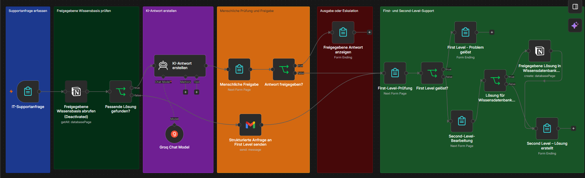

# 🤖 Michi's SmartDesk
## KI-Assistent für den internen IT-Support

### 📌 Projektübersicht

Michi's SmartDesk ist ein KI-gestützter IT-Support-Assistent,
der im Rahmen meiner Weiterbildung zum KI-Integrationsmanager
als Praxisprojekt entwickelt wurde.

Das Projekt zeigt, wie sich wiederkehrende IT-Supportanfragen
mithilfe von künstlicher Intelligenz und automatisierten
Workflows effizienter bearbeiten lassen.

Als Beispiel dient die fiktive Bergmann Industriekomponenten GmbH.

### 🎯 Projektziele

- IT-Supportanfragen schneller bearbeiten
- Wiederkehrende Probleme automatisiert erkennen
- Vorhandenes IT-Wissen besser nutzen
- First-Level- und Second-Level-Support entlasten
- Menschliche Kontrolle bei KI-Antworten sicherstellen
- Neue Lösungen in einer Wissensdatenbank dokumentieren

### 🛠️ Verwendete Technologien

- **n8n:** Workflow-Automatisierung
- **Notion:** IT-Support-Wissensdatenbank
- **Groq / GPT-OSS-120B:** KI-gestützte Antworterstellung
- **Gmail:** Weiterleitung von Supportanfragen
- **n8n Forms:** Erfassung und Bearbeitung von Anfragen

### ⚙️ Funktionsweise

1. Ein Mitarbeiter meldet ein IT-Problem über ein Formular.
2. n8n sucht in der Notion-Wissensdatenbank nach einer passenden Lösung.
3. Bei einem Treffer erstellt die KI einen Antwortvorschlag.
4. Der Vorschlag wird vor der Verwendung manuell geprüft.
5. Bei fehlender Lösung wird die Anfrage an den First-Level-Support weitergeleitet.
6. Falls erforderlich, erfolgt eine Eskalation an den Second-Level-Support.
7. Neue, fachlich freigegebene Lösungen können in Notion dokumentiert werden.

### 🔒 KI-Governance und Datenschutz

Das Projekt berücksichtigt folgende Grundsätze:

- Human-in-the-Loop: Menschliche Freigabe von KI-Antworten
- Nutzung freigegebener Wissensdatenbankeinträge
- Keine eigenständigen Entscheidungen bei kritischen Anfragen
- Datenschutz und Zugriffskontrolle als Anforderungen
- Dokumentation und Nachvollziehbarkeit der Bearbeitung

### 🧪 Prototyp und Tests

Im Rahmen des Projekts wurde ein n8n-Prototyp erstellt
und mit verschiedenen IT-Supportanfragen getestet.

Erfolgreich getestet wurden unter anderem:

- Suche nach passenden Wissensdatenbankeinträgen
- Erstellung KI-gestützter Antwortvorschläge
- Manuelle Freigabe und Ablehnung
- Weiterleitung über Gmail
- Eskalation zum Second-Level-Support
- Speicherung einer neuen Lösung in Notion

### ⚠️ Grenzen des Prototyps

Der Prototyp ist keine vollständig produktionsreife IT-Supportlösung.

Für einen produktiven Einsatz wären insbesondere
weitere Datenschutzprüfungen, Zugriffskontrollen,
Protokollierung und technische Fehlerbehandlung erforderlich.

### 🚀 Weiterentwicklung

- Verbesserte Suche nach ähnlichen IT-Problemen
- Anbindung an ein Ticketsystem
- Rollenbasierte Freigabeprozesse
- Erweiterte Protokollierung
- Verbesserte Fehlerbehandlung
- Schrittweise Einführung im Unternehmen

### 👤 Projekt

**Projektname:** Michi's SmartDesk

**Projektart:** KI-Integration und Workflow-Automatisierung

**Kontext:** Weiterbildung zum KI-Integrationsmanager

**Unternehmen:** Bergmann Industriekomponenten GmbH (fiktiv)

## 🖼️ n8n-Workflow – Michi's SmartDesk

Der folgende Screenshot zeigt den Aufbau meines
KI-gestützten IT-Support-Assistenten in n8n.

